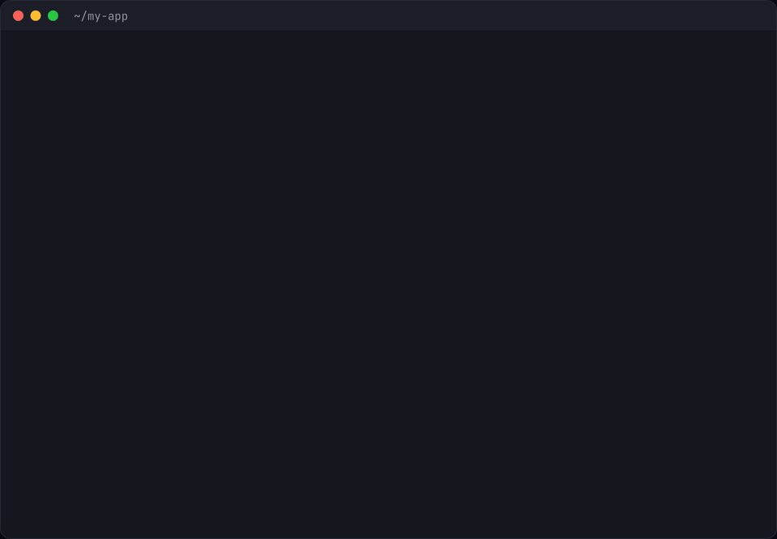

# stale-config

A Claude Code plugin that puts a bar above the prompt when your session's config goes stale on disk, and names the fix.



```
claude plugin install stale-config --marketplace darrentmorgan/claude-stale-config
```

Or let your agent do it. Paste this into Claude Code:

```
Install the stale-config plugin: fetch and follow https://raw.githubusercontent.com/darrentmorgan/claude-stale-config/main/INSTALL.md
```

Claude Code reads some config once, when a session starts. If you edit that config later, the session keeps running on the old version and gives no warning. This plugin notices, in two places:

- **The bar above the prompt.** It checks the watched files every few seconds, so it shows up soon after the edit, before you type anything. It says what changed and the fix. For `enabledPlugins` it has a **Reload** button that runs `/reload-plugins` for you. For MCP servers it says to restart with `claude --continue`, since nothing else loads them. **Changes** opens a side-by-side diff of just the part that counts. **Dismiss** hides it until the file changes again; **Snooze 30 min** hides it for a while.
- **One line on your next prompt**, from a hook, which also tells Claude what changed so it re-reads changed instruction files:

```
Stale config. MCP servers in .mcp.json changed. They load only at start: restart the session (claude --continue) to use them.
```

The bar is a Claude Code mod (a TypeScript hooks module, `hooks/session-health.tsx`). It was tested in the terminal on 2.1.311. Where mods don't draw (`claude -p`, the SDK), you still get the hook.

## What actually reloads (tested, not assumed)

Checked live on Claude Code 2.1.311: a multi-turn session, a file changed between turns, then the model asked what it can see.

| Change mid-session | Terminal session | Headless (`-p`, SDK) | This plugin says |
| --- | --- | --- | --- |
| `CLAUDE.md`, `AGENTS.md`, `.claude/rules/*.md`, `@imports` | reloads | **stays old** | re-read it (Claude does it on that prompt) |
| `enabledPlugins` in settings | **stays old** | **stays old** | run `/reload-plugins` |
| MCP servers (`.mcp.json`, `~/.claude.json`) | **stays old**, even in `/mcp` | **stays old** | restart (`claude --continue`) |
| `hooks` in settings | reloads | stays old | nothing |
| `env`, `permissions` in settings | reloads | reloads | nothing |

The table holds for one version only. Claude Code changes fast, so the hook encodes these results and its tests pin them.

## Install

The one-line install above needs Claude Code 2.1.292 or newer. On older versions, or from inside a session:

```
/plugin marketplace add darrentmorgan/claude-stale-config
/plugin install stale-config@stale-config
```

Sessions that were already open before the install never run the hook. Restart those once. To remove it: `claude plugin uninstall stale-config@stale-config`.

The clip above is a real take: a fresh Claude Code 2.1.311 session with the plugin installed, and an MCP server added to `.mcp.json` from another terminal. Nothing was typed into Claude; the bar came up on its own. Only the pauses were cut.

## Details

- **Watched:** `~/.claude/settings.json`, the project's `.claude/settings.json` and `settings.local.json`, and `.mcp.json`. It also watches the `mcpServers` in `~/.claude.json`, at user scope and this project's local scope. Then every `CLAUDE.md`, `CLAUDE.local.md` and `.claude/CLAUDE.md` from the project up to `~`, the project's `AGENTS.md`, `~/.agents/AGENTS.md` if you have one, and the rules folders. Last, every file those `@import`, anywhere in a line but not in code, up to five levels deep.
- **Only what's frozen counts.** In settings files it hashes only `enabledPlugins`. In MCP files it hashes only `mcpServers`. So when Claude Code writes your theme, a permission or its own stats, you get no warning. A settings file that didn't exist counts as an empty one.
- **Once per change.** After it warns about a change, it stays quiet until the file changes again. A file that is touched but has the same content is not a change.
- **`/clear` and compaction** reload instruction files but not settings. Settings are compared with the baseline from the claude process's first session.
- **`claude daemon`:** if the daemon started before your latest user-level change, its spare sessions run the old config. The plugin flags it once, with `claude daemon stop --any`.
- **The bar watches a shorter list:** the settings and MCP files above, `CLAUDE.md`, `.claude/CLAUDE.md`, `CLAUDE.local.md` and `AGENTS.md` in the project, and `~/.claude/CLAUDE.md` and `~/.agents/AGENTS.md`. Rules folders and `@imports` are left to the hook. A change to instruction files alone shows a quieter "Instructions changed" notice, which goes once your next message has run. It also names a plugin update, but only beside a settings change, whose Reload loads both: an update alone would nag in every open session.
- **Cost:** the hook is stdlib Python with no dependencies, and takes about 35 ms per prompt when nothing changed. The bar stats a dozen files every 5 seconds and reads one only when its time changes. Both skip `~/.claude.json` over 8 MB.
- **Fails open.** Any error gives `{}` and the session carries on. State goes in the plugin data folder and is pruned after 30 days.

## Limits

- In a terminal session, the instruction notice is a courtesy. Claude Code already has the new text.
- The bar's Reload in the desktop app fills in `/reload-plugins` for you to send, because Claude Code runs it there only when you send it yourself.
- Headless sessions keep their start-up `hooks`. This is not flagged, because a headless session can't reload them either.
- Process detection uses `ps`. On Windows the daemon check and the per-process baseline are skipped.

## Tests

```
python3 -m pytest tests
claude plugin test .
```

The first runs the hook's tests, the second the bar's.

MIT licensed.
